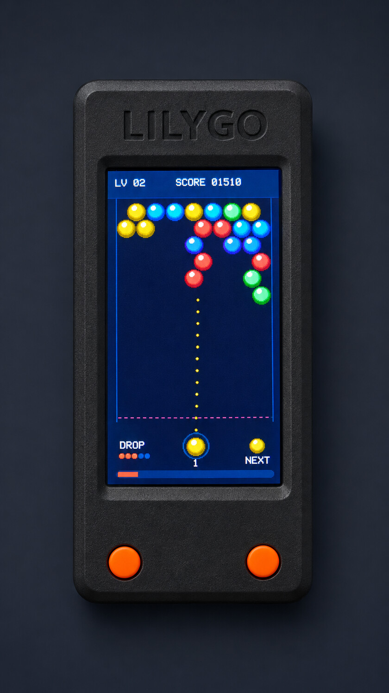

# Bubble Pop · 泡泡龙

用两个板载按键瞄准，倒计时结束后自动发射的泡泡龙。适配 LILYGO T-Display-S3 的 1.9 英寸 ST7789 LCD（170×320），使用 Arduino 和 LovyanGFX。

Two-button bubble shooter for the LILYGO T-Display-S3 LCD, with automatic firing after a four-second countdown.



## 玩法

- 按任一键开始。GPIO0 向左瞄准，GPIO14 向右瞄准。按住可连续调整角度。
- 每一发有 4 秒瞄准时间，倒计时结束后自动发射。虚线显示包括侧壁反弹在内的轨迹。
- 三颗以上相连的同色泡泡会消除，失去顶部支撑的泡泡也会掉落。
- 连续五发没有消除时，顶部增加一行。泡泡到达红线则游戏结束。
- 清空盘面后按任一键进入下一关，失败后按任一键重开。

## 编译和刷写

安装 PlatformIO，用 USB 数据线连接开发板，在仓库根目录运行：

```sh
pio run
pio run -t upload
```

## 许可

游戏源码采用 [MIT 许可证](LICENSE)。屏幕配置沿用 ESPressway32 的 MIT 授权代码，原版权声明见 [THIRD_PARTY_LICENSE](THIRD_PARTY_LICENSE)。
